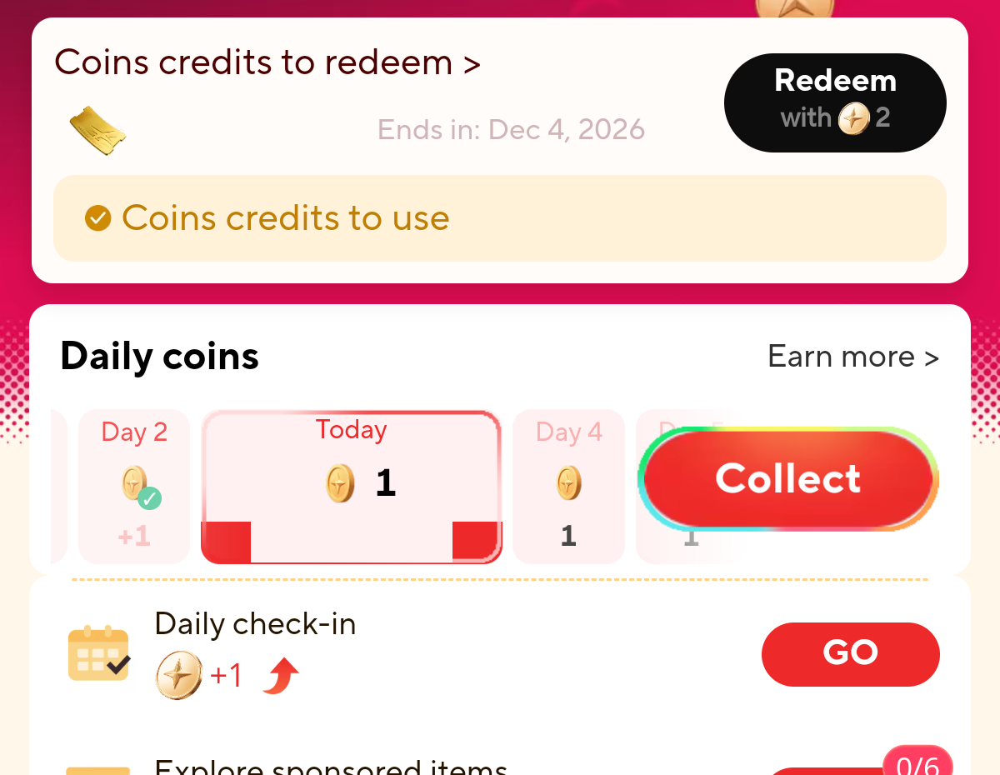

# aliexpress-coins

## What it is

An unattended collector for the AliExpress in-app **coins** programme. It drives the Android app
over wireless `adb` using screenshots and OCR — claiming daily sign-ins, browse-and-wait tasks,
the coins quiz, surprise items and notification tasks — and it never spends money, adds to cart,
places orders or redeems coins.



## Why it exists

AliExpress coins are worth little individually (≈ C$0.01 per coin). The value is not spending
twenty minutes every night tapping through promos and popups, and having a clear report when
something breaks.

## Requirements

- **Docker + Docker Compose** (the image bundles `adb`, `tini`, Python 3.14 and RapidOCR — no
  host Android SDK or Python needed).
- **An Android device on the same LAN with wireless `adb` enabled**, signed in to AliExpress,
  plugged into a charger, and **unlocked** (no PIN or biometric lock; the collector cannot enter
  one and stops with `device_locked` if the keyguard stays up).
- **Measured baseline:** AliExpress `com.alibaba.aliexpresshd` **`8.180.1`** on Android 15 (SDK
  35), `1200×2000` portrait @ 240 dpi (profile `c9b8f88670e295b5`), Canada / `en` store (`C$`).
  Another portrait phone is not refused at capture, but any popup lacking calibration for its
  profile fails safely as `popup_unclosable` instead of tapping a guess; another app version or
  store locale may change labels. See [`docs/06-runbook.md`](docs/06-runbook.md) §14 for the full
  portability limits.
- **Timezone rule:** `AECOINS_TIMEZONE` **must equal the device's `persist.sys.timezone`**. Both
  the nightly schedule and the daily state boundary follow it; if it disagrees with the device,
  the schedule can fire before the device's day rolls and report a successful, empty night.
  `doctor` prints both zones and fails on mismatch; `run --schedule` refuses to start (exit `2`).

## Quick start

### 1. Clone and configure `.env`

```sh
git clone git@github.com:alexmi256/aliexpress-coins.git
cd aliexpress-coins
cp .env.example .env
```

Edit `.env` and set your device serial (`host:port`) and its IANA timezone (if you have `adb` on
the host, read it with `adb -s <host:port> shell getprop persist.sys.timezone`; otherwise leave
`AECOINS_TIMEZONE=UTC` for step 2 and `doctor` will print the device's timezone for you):

```dotenv
AECOINS_DEVICE=192.168.8.65:5555
AECOINS_TIMEZONE=America/Toronto
```

### 2. Build and run `doctor`

```sh
docker compose build
docker compose run --rm collector python -m aliexpress_coins doctor
```

Expected output (all five checks `ok`, exit `0`):

```text
[ok] adb: Android Debug Bridge version 1.0.41 (/usr/bin/adb)
[ok] device: 192.168.8.65:5555 (device)
[ok] geometry: 192.168.8.65:5555: 1200x2000 @ 240 dpi, sdk 35, portrait, profile c9b8f88670e295b5
[ok] timezone: configured timezone America/Toronto; device timezone America/Toronto (192.168.8.65:5555)
[ok] ocr: RapidOCR loaded and read 'COINS' from its probe image
```

`doctor` is read-only: it connects the container's own `adb` server to `AECOINS_DEVICE`, checks
geometry, compares timezones, and probes OCR without tapping or launching the app. If a check
fails:

- **`device`** — confirm wireless debugging is enabled and `AECOINS_DEVICE` matches the current
  `host:port` (the wireless port rotates on reconnect).
- **`timezone`** — `doctor` prints `configured timezone ...; device timezone ...`; copy the
  device timezone into `AECOINS_TIMEZONE` in `.env` and re-run `doctor`.
- **`geometry`** — a profile id other than `c9b8f88670e295b5` is normal on another phone (still
  `[ok]`), meaning popup fallbacks are uncalibrated for that device.

### 3. Dry run (zero in-app taps)

```sh
docker compose run --rm collector python -m aliexpress_coins run --once --dry-run
```

Expected output (`taps issued: 0`, exit `0`):

```text
run 20261123T170916Z: planned
detail: dry run: 2 task(s) planned, 1 refusal(s); no tap was issued
plan: dry run: 2 task(s) planned, 1 refusal(s); no tap was issued
  1. Daily coins [daily_checkin] category=sign_in rule=daily_checkin
  2. Explore sponsored items [sponsored_items] category=browse_wait rule=sponsored_items
  refused: Browse surprise items code=game_play_and_earn rule=game_play_and_earn reason=game: Play & Earn is a mini-game and is never played
  taps issued: 0
summary: /app/runs/20261123T170916Z/summary.md
run.json: /app/runs/20261123T170916Z/run.json
```

A refusal is expected safety behaviour, not an error. A non-zero dry run means the surface did not
settle cleanly (`surface_*` / `navigation_failed`) — retry or inspect before going live.

### 4. Take one supervised night

Run one real night manually (well outside the scheduled window) and read its report:

```sh
docker compose run --rm collector python -m aliexpress_coins run --once
docker compose run --rm collector cat /app/runs/<run-id>/summary.md
```

Confirm `Status: completed`, positive task evidence, and `Back on coins page: yes`.

### 5. Start the nightly daemon

```sh
docker compose up -d
docker compose logs --tail 5 collector
```

Expected log line (`03:30` local default via `AECOINS_SCHEDULE_TIME`, plus up to 180 s jitter via
`AECOINS_SCHEDULE_JITTER_SECONDS`):

```text
2026-11-23 16:31:14,439 INFO {"event":"schedule_wait","next_fire":"2026-11-24T03:31:31.431469-05:00","seconds":57616.992}
```

Stop cleanly with `docker compose stop` (`tini` forwards `SIGTERM` and writes the report within
the 5 s grace period). Runs sharing the `state` volume coordinate on `state/run.lock`: a manual
`run --once` exits `3` while the daemon is mid-night, and the daemon waits for a manual run before
re-checking whether the day is already done.

## What a run does

1. **Hygiene & route** — wakes the screen, checks the keyguard is clear, locks portrait rotation,
   enables `stayon`, warm-starts AliExpress (`FirstActivity`), fires the coins shortcut deep link,
   sweeps popups, and opens `Coins boost` (`Earn more`), recovering with a warm re-entry if the
   empty-boost load fault appears.
2. **Roster & policy** — reads visible task rows via OCR and classifies every row against
   `specs/tasks.yaml` before dispatch (default-deny).
3. **Executors** — claims both independent daily sign-ins (streak `Collect` and boost
   `Daily check-in`), then walks allowed rows within `AECOINS_MAX_TASKS_PER_RUN` (default 12) and
   `AECOINS_RUN_BUDGET_SECONDS` (default 2700 s): browse-and-wait (timer chip), coins quiz
   (answers from and learns into [`data/quiz_bank.json`](data/README.md)), surprise items (3
   distinct products per round), and notifications. Every task requires positive on-screen
   verification.
4. **Report & retention** — returns to the coins page, restores device settings, writes
   `/app/runs/<UTC timestamp>/` (`summary.md`, `run.json`, `run.jsonl`, `roster.jsonl`,
   `shots/*.png` + OCR sidecars) in the `runs` Docker volume, and prunes beyond
   `AECOINS_KEEP_RUNS` (default 30). Daily state lives in the `state` volume; learned quiz
   answers persist in the `data` volume.
5. **Notifications (optional)** — set `AECOINS_APPRISE_URL` (plus optional `AECOINS_APPRISE_KEY`
   and `AECOINS_APPRISE_TAG`) in `.env` for one Apprise message per run (or use the legacy
   `AECOINS_WEBHOOK_URL` / `AECOINS_NTFY_TOPIC` settings; configure only one transport). Messages
   never contain the account name, an absolute balance, or order details (`AECOINS_NOTIFY_BALANCE_DELTA=true`
   opts in to the delta only), and a failed notification never fails a run.

## Safety posture

The collector drives a device that a human may also use. Four rules are enforced in code:

- **Default-deny before dispatch:** the deny list is enforced by `DispatchGate` **before** any
  task executor sees a row (sealed authorization token), and unknown task labels are skipped as
  `unrecognised`.
- **Refused by policy (never tapped):** mini-games (`Play & Earn`, `Merge Boss`, `GoGo Match`,
  `Prize Land`, `Shelf Shuffle`), currency conversion (`water`, `diamonds`, `energy`), purchases,
  checkout, order placement, adding to cart, coin redemption, leaving reviews, and
  sharing/referrals.
- **No blind coordinate taps:** every tap comes from a matched OCR box on a fresh screenshot,
  except per-profile calibrated popup fallbacks guarded by an OCR anchor.
- **Runtime abort guard & dry-run:** `SafetyGuard` aborts immediately on a live `dangerous_control`
  (buy/order/cart/redeem), a `balance_decreased` reading, or three identical unrecognised screens
  that fail recovery; `--dry-run` suppresses in-app taps entirely (`taps_issued: 0`).

## How it works

The AliExpress coins container (`AdcActivity`) and its popups expose no usable accessibility tree,
so perception is **screenshot → RapidOCR → `TextBox[]`**. Row pairing uses frame-proportional
tolerances (`2.25 × median` box height), scrolling is search-based, popup close glyphs scale from
frame width, and last-resort popup fallbacks are keyed by `doctor`'s geometry profile id. Every
dispatched row crosses `DispatchGate`, concurrent runs coordinate on `state/run.lock`, and every
error maps to one of 16 typed failure codes with an explicit retry policy (`stage ×1`, `task ×1`
only when `acted=False`, or `none`).

| document | contents |
|---|---|
| [`docs/06-runbook.md`](docs/06-runbook.md) | operator reference: local setup, reports, failure codes, portability limits |
| [`docs/02-architecture.md`](docs/02-architecture.md) | package layout (`src/aliexpress_coins/`), data flow, invariants, ADRs |
| [`docs/05-app-knowledge.md`](docs/05-app-knowledge.md) | measured AliExpress behaviour, task surface, navigation map, open unknowns |
| [`docs/03-conventions.md`](docs/03-conventions.md) | enforced engineering rules, testing seams, requirements & decisions of record |

## Troubleshooting

See [`docs/06-runbook.md`](docs/06-runbook.md) §9 (*When a night claims nothing*) and §10
(*Troubleshooting by failure code*), which lists the meaning, operator check, and retry rule for
every failure code and is verified against the code by `tests/test_docs.py`.

## Licence and contributors

**Licence:** Private project, no licence granted.

**Contributing:** local development uses Python 3.14, plain `venv` + `pip`, and
[`just`](https://github.com/casey/just) (no uv, poetry, hatch or pdm; keep the checkout path free
of `{` and `}`). Run `just setup`, use `just check-fast` while iterating, and run `just check`
(ruff lint, ruff format check, mypy strict over `src/` and `tests/`, and pytest with the coverage
ratchet — current floor **99.47%** in `pyproject.toml`) before opening a PR. Read
[`AGENTS.md`](AGENTS.md) and [`docs/03-conventions.md`](docs/03-conventions.md) first; recorded
test fixtures are documented in [`tests/data/README.md`](tests/data/README.md).
