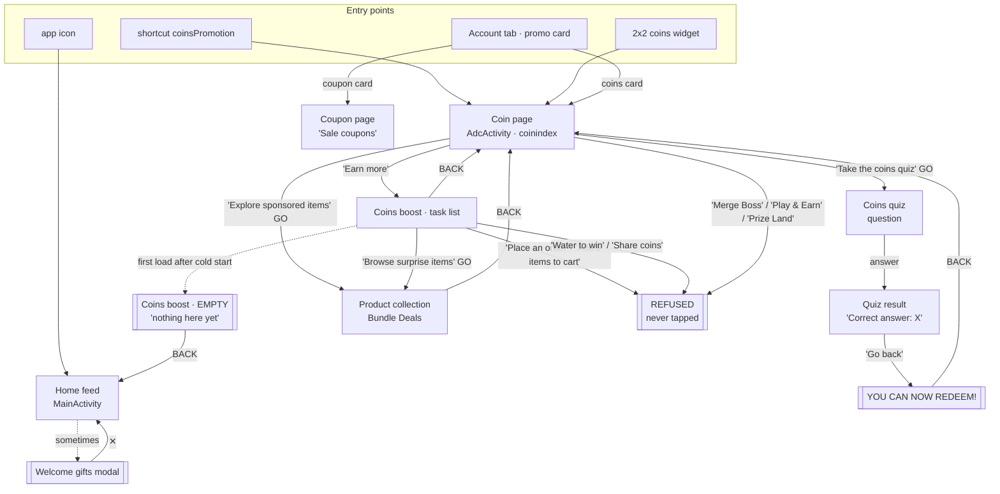

# 06 — Navigation map

The app as a state machine: how a run enters, which screens it can reach, how each screen is
recognised from a screenshot, and where it gets stuck. This is the document the perception and
task issues point at — a screen classifier needs markers, and a task executor needs to know which
transition it is making.

Legend: ✅ observed on the device · ⬜ inferred from an observation · ❓ unknown.

---

## 1. Entry points

| entry | intent / action | lands on | notes |
|---|---|---|---|
| app icon | `am start -n com.alibaba.aliexpresshd/com.aliexpress.app.FirstActivity` | home feed (`MainActivity`) | cold start; a "Welcome gifts" modal appears **sometimes** ✅ |
| **shortcut** | `am start -a android.intent.action.VIEW -d 'aliexpress://goto?url=<encoded m.aliexpress.com/p/coin-index/index.html>'` | **coin page** (`AdcActivity`, `adc_manifest=coinindex`) | the app's own route; what the pinned `coinsPromotion` shortcut fires ✅ |
| **widget** | tap `AECoin2x2NormalWidget` → same page + `from=widget&user_growth_scene=widget&aewidget_*` | **coin page** | the parameter set is how the app knows a widget visit happened ✅ |
| account tab | bottom nav `Account` → promo card | varies | the card rotates between a **coins** card and a **coupons** card ("Daily rewards are ready!") ✅ |
| advertised link | `am start -d https://www.aliexpress.com/p/coin-index/…` | blank web view | wrong shape; needs the `aliexpress://goto?url=` wrapper ❌ |

**Two operational rules fall out of the measurements:**

1. **Fire the intent from a stopped app.** `am force-stop` then `am start` is deterministic. The
   same intent fired while the app is already running and showing the home feed did **not**
   navigate — the dispatcher ignored it and the feed stayed on top ✅.
2. **Force-stopping resets the task cache too.** The first `Earn more` after a cold start renders
   the task list **empty** (the stuck state, §5); the same tap on a warm page renders it fully.

## 2. The screen graph

## 3. Screen identification (what the classifier keys on)

| screen | marker | false positives to avoid |
|---|---|---|
| home feed | `AliExpress` logo + category tabs (`Explore`, `Black Friday`) + bottom nav | the coin page also says `Coins` |
| account page | `My orders`, `History`, `Wishlist`, `Coupons` | — |
| **coin page** | `Coins` + `Daily coins` + `Coins credits to redeem` | the account page shows a `Coins` card without `Daily coins` |
| **coins boost (task list)** | `Coins boost` + at least one task title | the empty state has the same header |
| coins boost empty | `Coins boost` + `There's nothing here yet` | red background is a style, not a marker |
| quiz | `Coins quiz` + `True` / `False` | — |
| quiz result | `Correct answer:` + `Your answer:` | — |
| redeem interstitial | `YOU CAN NOW REDEEM!` | — |
| product collection | `Bundle Deals` / `Hot picks for you` + prices | any product page looks like this |
| coupon page | `Sale coupons` + `Collect all: C$…` | — |

## 4. Transitions and what they cost

| from | action | to | verification |
|---|---|---|---|
| coin page | tap `Earn more` | boost list | `Coins boost` header appears |
| boost list | tap a row's `GO` | task page | the coin page is left; `is_coins_page` false |
| coin page | tap quiz `GO` | quiz | `Coins quiz` present |
| quiz | tap an option | result | `Correct answer:` present |
| result | tap `Go back` | redeem interstitial | `YOU CAN NOW REDEEM!` present |
| interstitial | BACK | coin page | `Daily coins` present |

## 5. Stuck states and recovery

| stuck state | how it is detected | recovery |
|---|---|---|
| **boost list empty** (`There's nothing here yet`) right after a cold start | header `Coins boost` + the empty sentence, and **zero task rows** | BACK to the coin page, re-fire the shortcut intent (or tap the widget), then `Earn more` again — the warm page populates ✅ |
| home feed where a page was expected | no coin/boost marker after a navigation | force-stop → fire the shortcut intent; `am start` alone does not navigate a running app ✅ |
| tap did nothing | before/after frame diff ≈ 0 (see §6) | re-capture and re-resolve the target; do not repeat the same coordinate |
| a task row vanished between capture and tap | the label is missing at tap time | treat as `no longer available`, never tap the stale coordinate |

**The general rule the operator stated, now backed by observation:** *"no tasks to do" is a fault,
not a state.* There are always declined tasks on the list (games, order, water, share), so an
empty list means the page failed to load — reset instead of concluding the day is done.

## 6. Change detection

A tap is not evidence. Capture, tap, capture again, and compare 36×60 grayscale thumbnails
(mean absolute difference):

* `diff > ~0.02` — something changed (a page swap measured 0.19–0.40);
* `diff ≈ 0.00–0.01` — nothing moved; the tap missed, or the app ignored it (measured
  0.007–0.010 on the home feed when a stale coordinate was tapped).

This is the cheapest stuck-detector available and belongs in the controller, not in a task.

## 7. Open questions about the map

| question | where it matters |
|---|---|
| does the "Browse surprise items" GO open a *new* page, or the product grid on the boost page? | #26 — the row says "Tap 3 items on this page" |
| is the empty boost state time-based (a rate limit) or purely a cold-cache effect? | #38 — how hard to retry |
| can the widget intent be fired without the widget installed (`am start` of its exact URI)? | #27, #38 — route fallback |
| does the account-page coins card ever appear when the coupon card is showing? | route fallback reliability |
