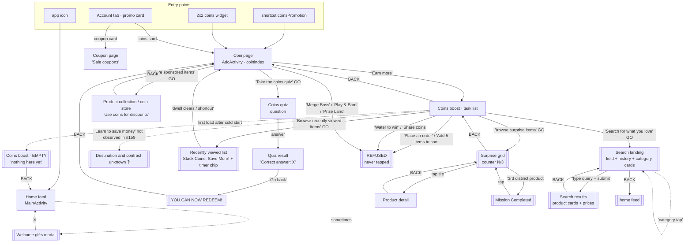

# 07 — Navigation map

Screen graph, OCR identification markers, transitions, and stuck-state recovery for AliExpress
`8.180.1`. Legend: ✅ observed on the device · ⬜ inferred · ❓ unknown.

## 1. Entry points and warm-start ordering ✅

| entry | action | lands on | notes |
|---|---|---|---|
| app icon | `am start -n com.alibaba.aliexpresshd/com.aliexpress.app.FirstActivity` | home feed (`MainActivity`) | cold start; `Welcome gifts` modal sometimes ✅ |
| **shortcut** | `am start -a android.intent.action.VIEW -d 'aliexpress://goto?url=https%3A%2F%2Fm.aliexpress.com%2Fp%2Fcoin-index%2Findex.html'` | **coin page** (`AdcActivity`) | primary route; works with `coinsPromotion` uninstalled ✅ |
| widget | `AECoin2x2NormalWidget` (`from=widget&…`) | coin page | captured; fallback descoped (#27) ✅ |
| Account tab | bottom nav `Account` → promo card | varies | rotates between coins and coupons ✅ |
| bare `https://…/p/coin-index/` | `am start -d https://…` | blank WebView | missing `aliexpress://goto?url=` wrapper ❌ |

**Warm-start ordering rule (2026-11-20):** the shortcut intent is a navigation command, not a launch
command — `force-stop` → intent gave an **empty** boost page (4/4), whereas `FirstActivity` + ~10 s
settle → intent (2/2) and warm app → intent (3/3) gave a **populated** list.

## 2. Screen graph

## 3. Screen identification markers ✅

| screen | OCR markers | false positives to avoid |
|---|---|---|
| home feed | `AliExpress` logo + category tabs + bottom nav | coin page also says `Coins` |
| account page | `My orders`, `History`, `Wishlist`, `Coupons` | — |
| **coin page** | `Coins` + `Daily coins` + `Coins credits to redeem` | Account page shows `Coins` without `Daily coins` |
| **coins boost** | `Coins boost` + at least one task title | empty state shares the header |
| coins boost empty | `Coins boost` + `There's nothing here yet` | red header is style, not marker |
| quiz / quiz result | `Coins quiz` + 2 or 4 OCR options / `Correct answer:` + `Your answer:` | never assume option count |
| redeem interstitial | `YOU CAN NOW REDEEM!` | — |
| product collection | `Bundle Deals` / `Hot picks for you` + prices | — |
| coin store (sponsored) | `Use coins for discounts` + `Disc:` / `Applied` + right-edge dwell chip | require header, not feed `discount` |
| **recently viewed list** | `Recently viewed` + `Stack Coins, Save More!` + `History` / `Cart` tabs + right-edge dwell chip | the boost row shares `Browse recently viewed items`; the destination header alone is not a task row, and the page has no badge |
| surprise grid | `Browse surprise items` + `Tap 3 items on this page` + `N /3` | boost row shares title; grid adds `N /3` |
| surprise grid (scrolled) | two columns of card titles with price lines for the guard; the executor matches labels already read this round | header and pill are above the viewport; generic discount copy is not enough, and the executor restores the top before reading the counter (#100) |
| **search landing** | `Discover more` + category cards with item-count lines (a `Search history` section may sit above it) | the heading alone is generic feed copy; boost row shares `Search for what you love`, and history text is account data, not an identifier |
| **search results** | the submitted query in the top field + product prices + `N sold` copy; no `Discover more` grid | a category tap does not leave the landing or submit; a coupon/coin page can share prices, so require the query or the top field copy and exclude known pages |
| product detail | `Item 1/n` or `Add to cart` + `Buy now` | BACK only; never tap purchase controls |
| mission overlay / coupon | `Mission Completed` over dimmed grid / `Sale coupons` + `Collect all: C$…` | — |
| non-app clock surface | status-bar `H:MM` + weekday/day widget + no app content | a clock alone appears on every app frame; the date widget and empty content are required. Launchers with icons use the foreground-package probe |

**Portability (`1080×1920 @ 320 dpi`):** text markers, label lookups, and graph topology port;
coordinates, scroll distances, and unscaled crops do not (modal close fraction drifted `0.826 → 0.789`).

## 4. Transitions and verification ✅

| from | action | to | verification |
|---|---|---|---|
| coin page | tap `Earn more` | boost list | `Coins boost` header + rows present |
| boost list | tap row's `GO` | app destination, or foreground-loss recovery | timer/known app page; a `non_app` frame or non-AliExpress focus saves evidence, warm-starts and re-enters, then fails `foreground_lost_after_action` without claiming completion (#116) |
| coin / boost | quiz `GO` → option → `Go back` | quiz → result → redeem / coin | `Coins quiz` → `Correct answer:` → BACK on redeem |
| boost list | surprise `GO` → tile → BACK | grid → detail → grid | `N /3` advances on distinct product; tap `Mission Completed` at `3/3` |
| boost list | search `GO` → focus field → type query → enter | landing → keyboard → results | results must show the query + a product price; returning row badge `0/2 → 1/2`; after the second verified search the row is gone from the populated list. The measured category tap did not navigate or submit and is not a search (#142). |
| boost list / inline | recently-viewed `GO` | `Recently viewed` list | right-edge chip clears after the dwell; shortcut returns to the coin page; the row is gone from the populated boost list and the balance moved +1 (#116) |
| boost list | notifications `GO` | claimed / pre-prompt / dialog / OS settings | check + balance, `Allow`, or stop at `All AliExpress notifications` |

## 5. Stuck states, change detection & recovery ✅

| stuck state | detection | recovery |
|---|---|---|
| **empty boost list** | `Coins boost` + `"There's nothing here yet"` + zero rows | warm `FirstActivity` + shortcut intent (§1); never an empty day |
| home feed / unknown screen | no coin/boost marker; 3 identical frames in a task | up to 3 warm shortcut entries; abort run only if recovery fails |
| non-app foreground after browse `GO` | clock/date `non_app` frame, or current window package is not AliExpress | save `browse-<key>-foreground-lost.*`; warm-start if needed; shortcut re-entry; fail `foreground_lost_after_action`; the next acted-row recheck is `already_done` if the row is now gone, otherwise it retries (#116) |
| swallowed tap | 36×60 thumbnail MAD `≈ 0.00–0.01` (page swap `0.19–0.40`) | one bounded retry (2 attempts total) on re-verified unchanged frame |
| vanished task row | label missing on fresh capture at tap time | report `no longer available`; never tap stale coordinates |

Widget-route fallback is descoped (#27); open map questions live in [`05-app-knowledge.md`](05-app-knowledge.md) §8.
