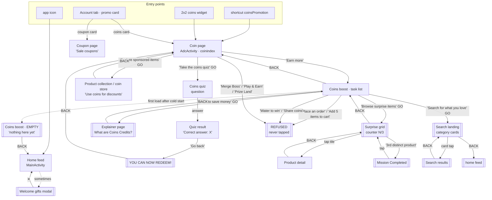

# 07 — Navigation map

The app as a state machine: how a run enters, which screens it can reach, how each screen is
recognised from a screenshot, and where it gets stuck. This is the document the perception and
task issues point at — a screen classifier needs markers, and a task executor needs to know which
transition it is making.

Legend: ✅ observed on the device · ⬜ inferred from an observation · ❓ unknown.

---

## 1. Entry points

| entry | intent / action | lands on | notes |
|---|---|---|---|
| app icon | `am start -n com.alibaba.aliexpresshd/com.aliexpress.app.FirstActivity` | home feed (`MainActivity`) | cold start; a "Welcome gifts" modal appears **sometimes** ✅ |
| **shortcut** | `am start -a android.intent.action.VIEW -d 'aliexpress://goto?url=<encoded m.aliexpress.com/p/coin-index/index.html>'` | **coin page** (`AdcActivity`, `adc_manifest=coinindex`) | the app's own route; what the pinned `coinsPromotion` shortcut fires. **Verified to work with the shortcut uninstalled** — the intent does not depend on the launcher item ✅ |
| **widget** | tap `AECoin2x2NormalWidget` → same page + `from=widget&user_growth_scene=widget&aewidget_*` | **coin page** | the parameter set is how the app knows a widget visit happened ✅ |
| account tab | bottom nav `Account` → promo card | varies | the card rotates between a **coins** card and a **coupons** card ("Daily rewards are ready!") ✅ |
| advertised link | `am start -d https://www.aliexpress.com/p/coin-index/…` | blank web view | wrong shape; needs the `aliexpress://goto?url=` wrapper ❌ |

**The ordering rule (measured, 2026-11-20):**

1. **Start the app normally, let it settle, then send the intent.** Two paths, opposite results:

   | sequence | `Earn more` result | trials |
   |---|---|---|
   | `am force-stop` → fire the intent (the intent cold-starts the app) | **empty** boost page | 4/4 |
   | `am start -n …FirstActivity` → settle ~10 s → fire the intent | **populated** | 2/2 |
   | app already warm → fire the intent | **populated** | 3/3 |

   So the intent is a *navigation* command, not a *launch* command. Using it as the cold start
   leaves the hybrid container without the session state the boost page needs.
2. A warm app **does** accept the intent — an earlier single observation that it did not was a
   fluke, and is retracted here. What matters is that the app has already rendered a page in
   that process.

## 2. The screen graph

## 3. Screen identification (what the classifier keys on)

| screen | marker | false positives to avoid |
|---|---|---|
| home feed | `AliExpress` logo + category tabs (`Explore`, `Black Friday`) + bottom nav | the coin page also says `Coins` |
| account page | `My orders`, `History`, `Wishlist`, `Coupons` | — |
| **coin page** | `Coins` + `Daily coins` + `Coins credits to redeem` | the account page shows a `Coins` card without `Daily coins` |
| **coins boost (task list)** | `Coins boost` + at least one task title | the empty state has the same header |
| coins boost empty | `Coins boost` + `There's nothing here yet` | red background is a style, not a marker |
| quiz | `Coins quiz` + `True` / `False` | — |
| quiz result | `Correct answer:` + `Your answer:` | — |
| redeem interstitial | `YOU CAN NOW REDEEM!` | — |
| product collection | `Bundle Deals` / `Hot picks for you` + prices | any product page looks like this |
| coin store / sponsored list | `Use coins for discounts` + `Disc:`/`Applied` price tiles + the right-edge dwell chip | a feed tile can say `discount`; only the whole-page header names this surface (#83) |
| surprise grid | `Browse surprise items` + `Tap 3 items on this page` + `N /3` | the boost row carries the same title and subtitle; the grid adds the counter |
| product detail (surprise) | `Add to cart` + `Buy now` + `Item 1/n` in the toolbar | every product page looks like this — BACK, never tap a purchase control |
| mission overlay | `Mission Completed` + coin artwork over a dimmed grid | — |
| coupon page | `Sale coupons` + `Collect all: C$…` | — |

## 3b. What ports between devices, and what does not

Verified by re-running the map at 1080×1920 @ 320 dpi on the same hardware:

* **ports** — screen markers (§3), because they are text; label lookups, because OCR finds the box
  wherever it is; the run loop's topology (§2), because it keys on markers.
* **does not port** — every coordinate, every scroll distance, and every template crop. Even the
  modal's close control, expressed as a fraction of height, moved from 0.826 to 0.789 because the
  aspect ratio changed.

The boost page also served a **different task roster** at the second geometry: `Search for what you
love` (0/2, "Earn by using keywords to explore items") appeared where `Browse surprise items` had
been. The catalogue must therefore be pattern-based and tolerate absent tasks — which is what
`specs/tasks.yaml` already does.

## 4. Transitions and what they cost

| from | action | to | verification |
|---|---|---|---|
| coin page | tap `Earn more` | boost list | `Coins boost` header appears |
| boost list | tap a row's `GO` | task page | the coin page is left; `is_coins_page` false |
| coin page | tap quiz `GO` | quiz | `Coins quiz` present |
| quiz | tap an option | result | `Correct answer:` present |
| result | tap `Go back` | redeem interstitial | `YOU CAN NOW REDEEM!` present |
| interstitial | BACK | coin page | `Daily coins` present |
| boost list | tap `Browse surprise items` `GO` | surprise grid | counter `N /3` present |
| surprise grid | tap a product tile | product detail | `Add to cart` / `Buy now` present |
| product detail | BACK | surprise grid | the counter advanced for a distinct product, otherwise unchanged |
| surprise grid | third distinct product | mission overlay | `Mission Completed` present |
| mission overlay | tap the overlay | surprise grid | overlay gone, counter `3/3` |
| boost list | tap `Turn on notifications` `GO` | same row, completed | drawn check appears, balance +1, `POST_NOTIFICATION` unchanged (observed 2026-11-20) |
| app push settings | tap `Allow phone notifications` | OS app-notification page | `All AliExpress notifications` present; no runtime dialog |
| OS app-notification page | toggle `All AliExpress notifications` | same page with `Categories` | switch on; the permission is granted **without** a runtime dialog |
| app pre-prompt | tap `Enable all notifications` | system permission dialog | `Allow AliExpress to send you notifications?` present |

## 5. Stuck states and recovery

| stuck state | how it is detected | recovery |
|---|---|---|
| **boost list empty** (`There's nothing here yet`) | header `Coins boost` + the empty sentence, and **zero task rows** | caused by using the intent as the cold start; the fix is at the entry point — start the app normally, then fire the intent (§1). Re-entering a warm app also repopulates ✅ |
| home feed where a page was expected | no coin/boost marker after a navigation | start the app normally, settle, then fire the intent (§1); do not force-stop first |
| tap did nothing | before/after frame diff ≈ 0 (see §6) | re-capture and re-resolve the target; do not repeat the same coordinate |
| a task row vanished between capture and tap | the label is missing at tap time | treat as `no longer available`, never tap the stale coordinate |

**The general rule the operator stated, now backed by observation:** *"no tasks to do" is a fault,
not a state.* There are always declined tasks on the list (games, order, water, share), so an
empty list means the page failed to load — reset instead of concluding the day is done.

## 6. Change detection

A tap is not evidence. Capture, tap, capture again, and compare 36×60 grayscale thumbnails
(mean absolute difference):

* `diff > ~0.02` — something changed (a page swap measured 0.19–0.40);
* `diff ≈ 0.00–0.01` — nothing moved; the tap missed, or the app ignored it (measured
  0.007–0.010 on the home feed when a stale coordinate was tapped).

This is the cheapest stuck-detector available and belongs in the controller, not in a task.

## 7. Open questions about the map

The widget-route fallback is deliberately not implemented in #38. The launcher items were removed from
the reference device, and replaying the widget intent without the widget installed is unresolved pending
#27; the runner does not guess at that action. #38 uses the measured warm shortcut re-entry instead.

| question | where it matters |
|---|---|
| does the "Browse surprise items" GO open a *new* page, or the product grid on the boost page? | ✅ answered 2026-11-22: it opens a **new page** with its own header, subtitle and `N /3` counter; the boost row is not the grid. |
| is the empty boost state time-based (a rate limit) or purely a cold-cache effect? | #38 — how hard to retry |
| can the widget intent be fired without the widget installed (`am start` of its exact URI)? | #27, #38 — route fallback |
| does the account-page coins card ever appear when the coupon card is showing? | route fallback reliability |
